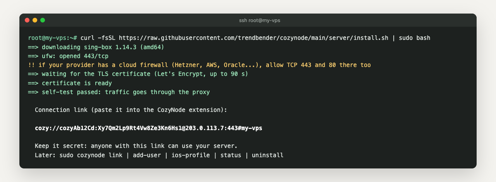
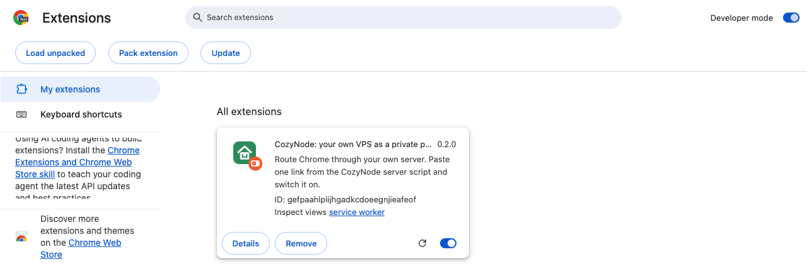
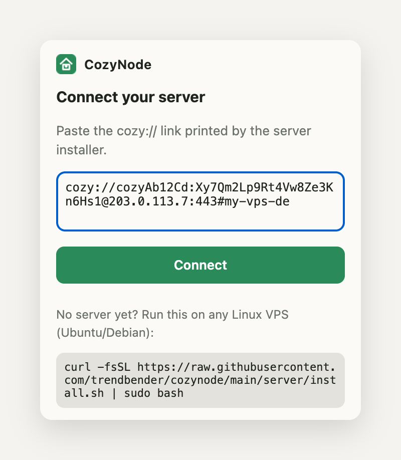
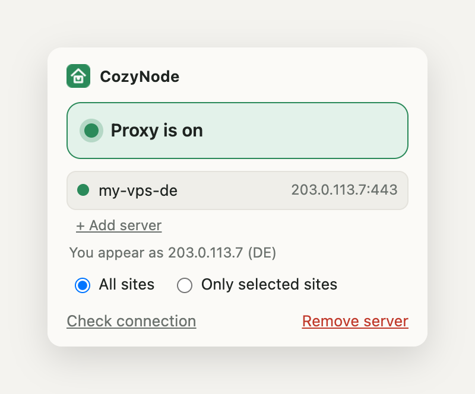
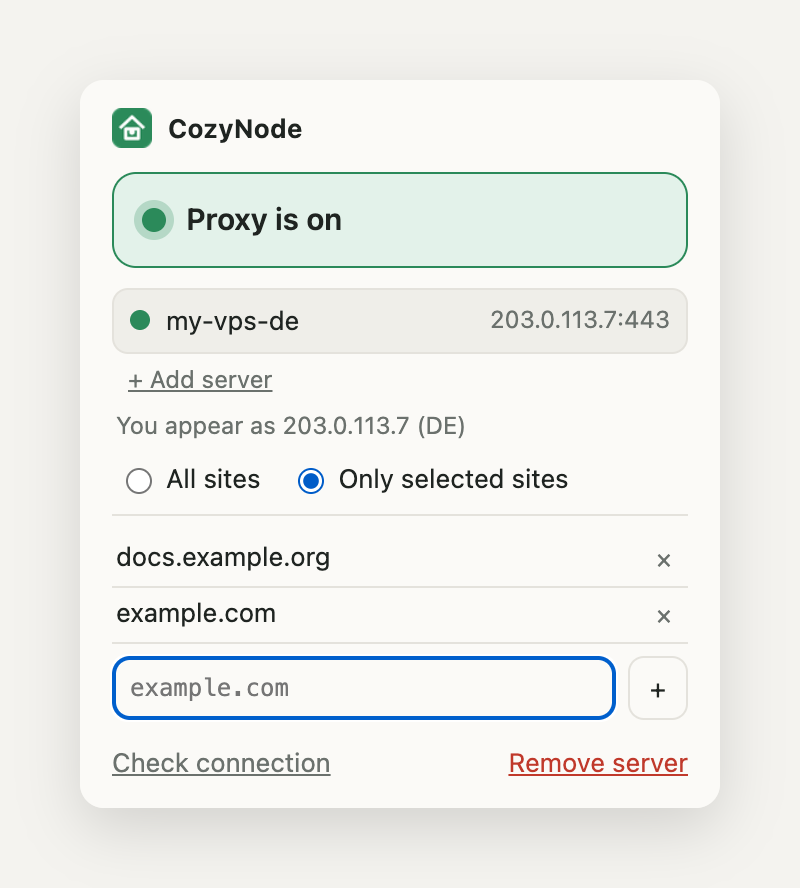
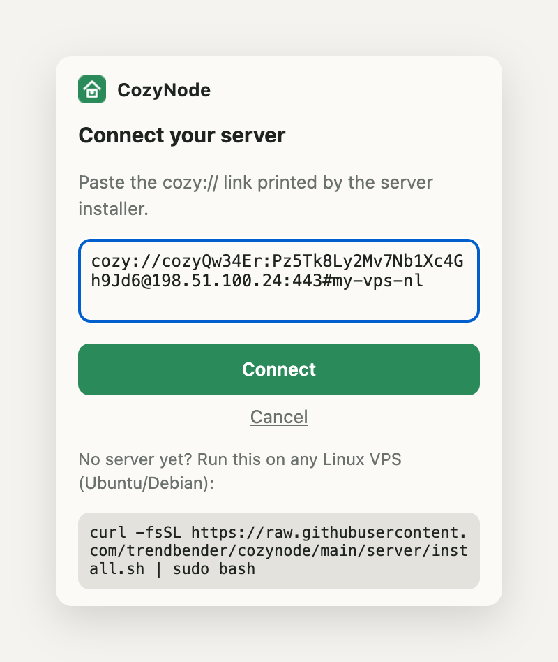
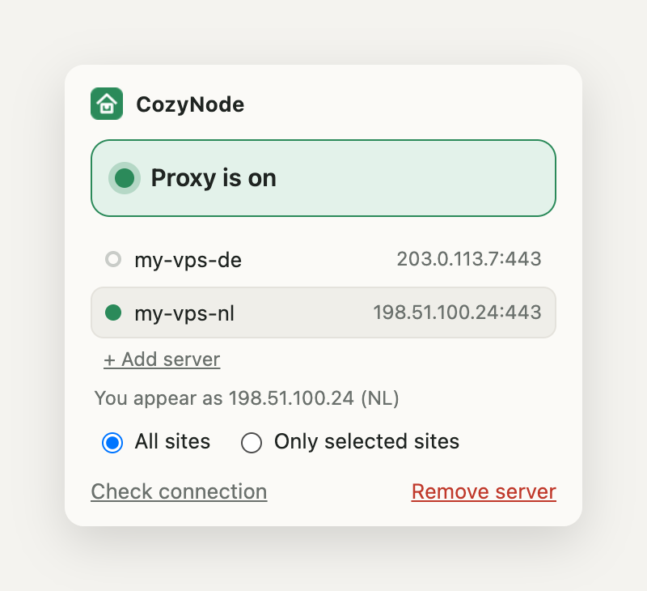
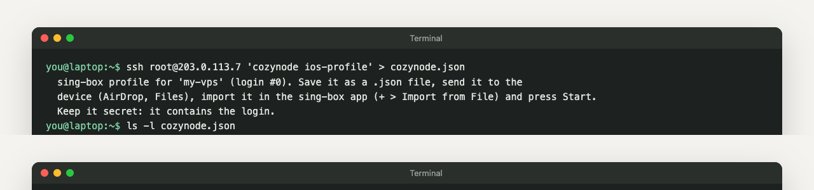

# CozyNode: пошаговая инструкция

[English version](guide.md)

CozyNode превращает арендованный Linux VPS в приватный HTTPS-прокси. Chrome подключается к нему через расширение CozyNode, телефон (iPhone, iPad, Android) — через бесплатное приложение sing-box к тому же серверу.

[](media/demo.mp4)

Все адреса и логины на этой странице — примеры.

- [1. Что понадобится](#1-что-понадобится)
- [2. Сервер](#2-сервер)
- [3. Chrome](#3-chrome)
- [4. Все сайты или только выбранные](#4-все-сайты-или-только-выбранные)
- [5. Несколько серверов](#5-несколько-серверов)
- [6. iPhone и iPad](#6-iphone-и-ipad)
- [7. Android](#7-android)
- [8. Свой логин каждому человеку и устройству](#8-свой-логин-каждому-человеку-и-устройству)
- [9. Если что-то не работает](#9-если-что-то-не-работает)
- [10. Обновить и удалить](#10-обновить-и-удалить)

## 1. Что понадобится

- VPS на Linux, процессор amd64 или arm64. Проверено на Ubuntu и Debian, хватает 512 МБ памяти. Сайты будут видеть страну сервера.
- Доступ root по SSH (`ssh root@203.0.113.7`).
- Открытые порты: TCP 443 (или 8443) для прокси и TCP 80 для бесплатного сертификата. Если у провайдера есть облачный файрвол в панели (Hetzner, AWS, Oracle, Google Cloud и другие), откройте порты и там.
- Домен не нужен: сертификат выдаётся прямо на IP сервера.

## 2. Сервер

Зайдите на сервер по SSH и выполните одну команду:

```bash
curl -fsSL https://raw.githubusercontent.com/trendbender/cozynode/main/server/install.sh | sudo bash
```



Примерно за минуту скрипт:

1. скачивает закреплённую версию [sing-box](https://github.com/SagerNet/sing-box) и сверяет её sha256;
2. создаёт случайные логин и пароль;
3. получает сертификат Let's Encrypt на IP сервера и дальше продлевает его сам;
4. открывает порт в `ufw` и проверяет, что трафик идёт через прокси;
5. печатает **ссылку для подключения** `cozy://логин:пароль@ip:порт#имя`.

Ссылка — единственный секрет. Кто её получит, тот сможет пользоваться вашим сервером, поэтому не выкладывайте её в чаты и тикеты.

Команды на потом (установщик добавляет короткую команду `cozynode`):

| Команда | Что делает |
|---|---|
| `sudo cozynode link` | показать ссылку ещё раз |
| `sudo cozynode add-user` | отдельный логин для другого человека или устройства |
| `sudo cozynode ios-profile [N]` | профиль для приложения sing-box на телефоне (логин N, по умолчанию 0) |
| `sudo cozynode status` | состояние службы и сертификата |
| `sudo cozynode install` | обновить sing-box и конфиг, логины сохраняются |
| `sudo cozynode uninstall` | удалить всё |

Параметры установки: `--port N` (по умолчанию 443, если он занят — 8443), `--name имя` (как сервер будет подписан в расширении), `--host IP|домен`.

### Сервер, на котором уже работают сайты

Если порты 80 и 443 уже заняты nginx, поставьте прокси на 8443, а с порта 80 пробросьте только проверку сертификата. Создайте файл, например `/etc/nginx/sites-enabled/cozynode-acme`, с IP вашего сервера:

```nginx
server {
    listen 80;
    server_name 203.0.113.7;
    location /.well-known/acme-challenge/ { proxy_pass http://127.0.0.1:18480; }
    location / { return 444; }
}
```

Пишите `listen 80;` без IP: строка `listen 203.0.113.7:80;` заберёт порт 80 этого адреса у остальных ваших сайтов. Затем:

```bash
sudo nginx -t && sudo systemctl reload nginx
curl -fsSL https://raw.githubusercontent.com/trendbender/cozynode/main/server/install.sh | sudo bash -s -- --port 8443 --acme-http-port 18480
```

Сайты продолжают работать как раньше. Через прокси собственные сайты сервера доступны только на портах 80 и 443, базы данных и админки на сервере недоступны вовсе.

## 3. Chrome

Установите CozyNode из Chrome Web Store. Пока карточка на проверке, расширение ставится вручную:

1. Скачайте `cozynode-<версия>.zip` со страницы [Releases](https://github.com/trendbender/cozynode/releases) и распакуйте.
2. Откройте `chrome://extensions`, включите **Режим разработчика** (справа вверху), нажмите **Загрузить распакованное** и выберите распакованную папку.



3. Закрепите расширение на панели: значок пазла, затем булавка рядом с CozyNode.
4. Нажмите на значок CozyNode, вставьте ссылку с сервера и нажмите **Подключить**.



5. Прокси включён. Под сервером видно, какой IP и какую страну теперь видят сайты. **Проверить** повторяет проверку.



Большая кнопка включает и выключает прокси. Пока он включён:

- DNS-запросы выполняет сервер, поэтому ваш провайдер не видит, какие сайты вы открываете;
- WebRTC идёт только через прокси, и видеозвонки в браузере не выдают ваш настоящий IP;
- локальные адреса (`localhost`, `192.168.x.x`, `10.x.x.x`) идут напрямую, роутер и локальные сервисы работают как обычно.

Скриншоты здесь на английском; в русском Chrome расширение показывает те же кнопки по-русски.

## 4. Все сайты или только выбранные

- **Все сайты**: весь трафик Chrome идёт через сервер.
- **Только выбранные**: через сервер идут только сайты из списка, остальные открываются напрямую и на полной скорости. Впишите домен и нажмите **+** или нажмите **Добавить example.com**, чтобы добавить сайт текущей вкладки. Домен включает свои поддомены: `example.com` покрывает и `www.example.com`, и `docs.example.com`.



Если сайт из списка всё равно не открывается, скорее всего, он грузит страницы с другого домена (CDN или API). Добавьте и его: домены видны в Chrome DevTools на вкладке Network.

## 5. Несколько серверов

Можно держать несколько серверов, например в разных странах, и переключаться между ними одним кликом.

1. Поставьте CozyNode на каждый сервер (раздел 2) и скопируйте каждую ссылку.
2. В расширении нажмите **+ Добавить сервер**, вставьте следующую ссылку и нажмите **Подключить**.



3. Все серверы в списке. Нажмите на сервер, чтобы переключиться: проверка ниже сразу покажет новый IP и страну.



**Удалить сервер** убирает только выбранный, остальные остаются. Если вставить ту же ссылку повторно, дубля не будет: запись обновится.

## 6. iPhone и iPad

Chrome на телефоне не поддерживает расширения, поэтому на телефоне через сервер идёт всё устройство целиком, через бесплатное приложение с открытым кодом **sing-box**. На сервере ничего менять не нужно.

Что работает: все приложения и все браузеры, DNS через сервер. TCP идёт через прокси, остальной UDP (QUIC) отклоняется, и приложения сами переходят на TCP. Голосовые и видеозвонки в мессенджерах, которым нужен UDP, при включённом приложении могут не соединяться.

**1. Установите приложение.** [sing-box MT в App Store](https://apps.apple.com/app/sing-box-mt/id6785326793) — официальный клиент sing-box (iOS 15 и новее; нужен Apple ID не из материкового Китая).

**2. Получите профиль на компьютере.** В Терминале на Mac или ПК:

```bash
ssh root@203.0.113.7 'cozynode ios-profile' > cozynode.json
```



Для второго сервера выполните ту же команду с его адресом и другим именем файла, например `cozynode-nl.json`. Чтобы у телефона был отдельный логин, создайте его командой `sudo cozynode add-user` и укажите номер: `cozynode ios-profile 1`.

**3. Перенесите файл на iPhone.** Проще всего AirDrop с Mac: файл попадёт в «Файлы › Загрузки». Можно и через iCloud Drive. В файле ваш логин, поэтому не пересылайте его через мессенджеры и почту.

**4. Импортируйте.** Откройте sing-box, на экране **Dashboard** нажмите **+** на карточке профиля, выберите **Import from File** и укажите `cozynode.json`. Подтвердите импорт.

**5. Запустите.** В первый раз приложение предложит **Install Network Extension**: нажмите и разрешите добавить конфигурацию VPN (iOS попросит код-пароль). Затем нажмите **Start**. В строке состояния появится значок VPN.

**6. Проверьте.** Откройте в Safari https://www.cloudflare.com/cdn-cgi/trace: в строках `ip=` и `loc=` должны быть ваш сервер и его страна.

Несколько серверов: импортируйте по профилю на каждый и переключайтесь выбором профиля на Dashboard. Выключить: **Stop** в приложении или VPN в Настройках.

## 7. Android

Так же, как на iPhone: приложение sing-box пускает весь телефон через ваш сервер.

**1. Установите приложение.** [sing-box в Google Play](https://play.google.com/store/apps/details?id=io.nekohasekai.sfa) или APK со страницы [GitHub Releases](https://github.com/SagerNet/sing-box/releases) или из F-Droid. Android 5.0 и новее.

**2. Получите профиль** на компьютере, как в шаге 2 для iPhone:

```bash
ssh root@203.0.113.7 'cozynode ios-profile' > cozynode.json
```

Профиль один и тот же для iOS, Android и настольного sing-box; команда просто называется `ios-profile`.

**3. Перенесите файл на телефон** через Quick Share, USB-кабель или своё облако. Не пересылайте его через мессенджеры: в нём ваш логин.

**4. Импортируйте.** Откройте sing-box, вкладка **Profiles**, нажмите **+**, выберите **Import from file** и укажите `cozynode.json`. Подтвердите кнопкой **Import**.

**5. Запустите.** На вкладке **Dashboard** нажмите **Start** и разрешите запрос на VPN-подключение.

**6. Проверьте** ссылкой https://www.cloudflare.com/cdn-cgi/trace в любом браузере.

## 8. Свой логин каждому человеку и устройству

Не делитесь своей ссылкой, выдайте каждому свой логин:

```bash
sudo cozynode add-user      # печатает новую ссылку, логин номер 1, 2, ...
sudo cozynode link 1        # снова показать ссылку логина 1
sudo cozynode ios-profile 1 # профиль для телефона с логином 1
```

Все логины работают одновременно. Чтобы отключить человека, удалите его запись из `/etc/cozynode/users.json` и выполните `sudo cozynode install`.

## 9. Если что-то не работает

| Что видно | Что делать |
|---|---|
| «Нет связи через сервер» в расширении | На сервере: `sudo cozynode status`. Если служба работает, порт где-то закрыт: проверьте `ufw status` и облачный файрвол в панели провайдера. |
| «Сервер не принял логин» | Ссылка устарела (сервер переустановлен или логин удалён). Возьмите новую командой `sudo cozynode link` и добавьте заново. |
| Установщик ждёт сертификат и сдаётся | Порт 80 недоступен из интернета. Откройте его в облачном файрволе или настройте nginx, как в разделе 2, если порт 80 занят сайтом. |
| В режиме «Только выбранные» сайт открывается без прокси | Добавьте другие домены, с которых сайт грузится (DevTools › Network). |
| Всё медленно | Выберите сервер ближе к себе или режим «Только выбранные», чтобы остальные сайты шли напрямую. |
| Телефон: приложение запускается, но ничего не открывается | Проверьте сервер ссылкой trace с компьютера. После переустановки сервера создайте профиль заново: логин сменился. |

## 10. Обновить и удалить

- Обновить сервер: `sudo cozynode install` (логины и ссылки остаются прежними).
- Удалить с сервера: `sudo cozynode uninstall`.
- Удалить из Chrome: правый клик по значку CozyNode, затем **Удалить из Chrome**. Настройки прокси Chrome вернутся к обычным.
- Телефон: удалите профиль в приложении sing-box или само приложение.

Приватность: расширение хранит ваши ссылки только на вашем устройстве и ничего не отправляет нам. Подробнее — в [политике конфиденциальности](privacy.md).
